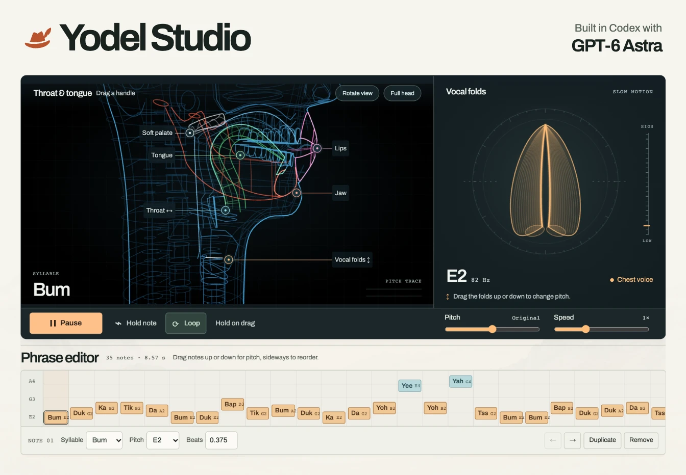

# Yodel Studio

**Built in Codex with GPT-6 Astra** · `gpt-6-astra`, max reasoning

Yodel Studio sings in your browser. Press **Play yodel**, grab the tongue or jaw to change a vowel, and pull the vocal folds to bend the pitch. You can turn the whole performance into a song of your own. [Play Yodel Studio](https://yodel-studio.hackhumanity.workers.dev/)

[](https://yodel-studio.hackhumanity.workers.dev/)

This project is a focused **fork and expansion of Jameson Hodge’s CHIMERA physical voice model**. Jameson built the simulated vocal tract, glottal source, singing planner and wireframe anatomy. Yodel Studio adds the yodel arrangements, chest-to-falsetto control, live instrument, phrase editor and portable remixes. [Original CHIMERA repository](https://github.com/jamesondh/chimera-vocal-synth) · [Jameson Hodge on X](https://x.com/jamesonhodge)

## Play it

- Choose a yodel from the menu. The pitch and speed sliders apply to the whole song.
- Drag the **lips, jaw, soft palate, tongue, throat or vocal folds** while the music plays. Turn on **Hold on drag** to linger on a syllable. Turn on **Rotate view** when you want to turn the head.
- Select a note in the **Phrase editor** to change its syllable, pitch or duration. Drag vertically to repitch it, sideways to reorder it, or duplicate it to repeat it. **Reset all** restores the controls and preset phrases. Named remixes stay in your song list.
- **Remix** makes a full copy you can name and edit. **Share** gives you a playable snapshot. Anyone can open it and make the next remix. The notes and mouth settings travel in the URL fragment, and named drafts save in the current browser.

## How I made the original performance

I started with a question about *The Lonely Goatherd* from *The Sound of Music*. What would it take for a simulated mouth and a pair of vocal folds to sing the yodel? The published answer was a 45-second solo arrangement of the Rodgers and Hammerstein song. [My original performance](https://x.com/klausbrave/status/2119372853502177323)

1. **Reverse-engineer the tune.** I used the opening 65 seconds of the film clip as a listening and timing reference. We measured recurring onsets in the mixed soundtrack and got a quarter-note pulse of about 0.30 seconds, or 200 BPM. We compared candidate notes against the strength of their harmonics, then checked the opening against published notation and the chorus against the original manuscript. The orchestra made some octave choices ambiguous. The final chorus phrase has approximate timing. [Film reference on YouTube](https://www.youtube.com/watch?v=UmmOJx_Hxto) · [Rodgers and Hammerstein manuscript](https://rodgersandhammerstein.com/wp-content/uploads/2020/11/The-Lonely-Goatherd.pdf)
2. **Write a score the mouth could sing.** We arranged 160 notes in 17 phrases in F major. Each event specified a pitch, duration, syllable in the International Phonetic Alphabet and vocal register. At 200 BPM a consonant cluster can use up most of the note. We shortened consonants to 65% of the planner’s usual duration and moved one pickup half a beat earlier so the following word had time to voice. [Live articulation planner](yodel/articulation.ts)
3. **Make the register break audible.** The native Rust renderer drove pitch at the glottal source. At each yodel break it switched pressure, tension, brightness, breathiness and the gap at the back of the vocal folds. The note pitch glided for six milliseconds while the mouth continued shaping the vowels and consonants. The film’s lead vocal was synthesized from that score. [Browser register controls](yodel/processor.ts)
4. **Give the singer a breath budget.** I wanted to know what the diaphragm was doing between phrases. We integrated airflow through the simulated airway to track a finite volume of air in the lungs. Passive recoil, diaphragm effort and abdominal effort determined the pressure available for a phrase. We scheduled short inhales at rests and checked whether there was enough air to sustain the closing vowel. Its 2.4-second note held voicing for 2.38 seconds. The lung outline, pressure readout and diaphragm curve in the film follow that same simulated state. In the interactive instrument we use regulated breath so you can hold a note as long as you like. [Respiration model](crates/chimera/src/voice/respiration.rs) · [Breathing tests](crates/chimera/tests/respiration.rs)
5. **Render the picture from the voice.** The native run wrote a 48 kHz vocal track and time-stamped telemetry. A browser canvas drew the cutaway head, slowed vocal-fold opening, airflow, pitch trace and captions from those timestamps. We added an original plucked bass-and-chord accompaniment underneath. A headless browser stepped the canvas through 1,350 frames, and FFmpeg combined those frames and the stereo mix into the 1600 × 900, 30 fps H.264 video. The output passed the per-note pitch and phrase checks. A separate listening check with automatic transcription still misheard some words.

## From film to playable instrument

I built the studio in **Codex with GPT-6 Astra** and iterated with Codex’s built-in browser pointed at localhost. I could play the phrase, miss a handle, hear which syllable was held, and see how far down I had to scroll to edit the next note. That led to six labelled grab targets, an opt-in head rotation control and a compact layout that puts the editor above the fold on a laptop.

The build compiles the Rust engine to WebAssembly. The browser loads the module once and runs a separate instance inside an AudioWorklet. The score schedules articulation on the audio clock. The UI reads pitch and tract geometry back from the simulation to draw the singer. The built app serves static files. Playback, editing, encoding a share link and decoding it all run on the listener’s device. [Audio integration](yodel/audio.ts) · [Live anatomy](yodel/views.ts) · [Song link format](yodel/song-links.ts)

## Run locally

Install Rust with rustup and Bun. The app was tested with Bun 1.3.13. Run these commands from the repository root.

```sh
rustup target add wasm32-unknown-unknown
bun install --frozen-lockfile
bun run dev
```

Open [the live-reload studio](http://127.0.0.1:5344/). Choose **Play yodel** to enable audio. TypeScript, CSS and HTML edits update the local page. After changing Rust, run `bun run wasm` and reload.

```sh
bun run test
bun run build
bun run preview
```

With the production preview running and Google Chrome installed, use a second terminal for `bun run test:browser`. It plays a shared song in an independent browser session, remixes it again and checks both generations. [Local production preview](http://127.0.0.1:5343/)

### Original scores and the hosted arrangement

The hosted studio preloads my film arrangement of **The Lonely Goatherd**. The song is by Richard Rodgers and Oscar Hammerstein II. The MIT license covers the code. The original music, lyrics, score and film recording retain their respective copyrights.

If you are rebuilding the hosted version and have the local *Goatherd* performance data, place its `performance.json` at `local-scores/goatherd.json` before running `bun run dev` or `bun run build`. The build imports the tempo, duration and timed vocal events. It keeps that input and the generated score out of Git.

## Hosting and security

Cloudflare serves the files in `yodel/dist` as Workers Static Assets. The build emits the same response headers used by the local production preview. Its Content Security Policy permits same-origin scripts, worklets and WebAssembly compilation. Responses disable MIME sniffing, referrer transmission and access to the microphone, camera and location. No microphone input is needed to synthesize a voice. [Static build configuration](yodel/vite.config.ts) · [Cloudflare configuration](wrangler.jsonc)

When a visitor opens a remix, the importer limits both the encoded and decompressed payload, accepts up to 256 notes, validates pitch, timing and anatomy ranges, and assigns new editor IDs. Song titles are rendered as text. There is no database or per-play API call. [Importer](yodel/song-links.ts) · [Round-trip and validation tests](tests/yodel-remixes.test.ts)

## Credits

Built by [Klaus Bravenboer](https://klaus.co.nz/) from [Hack Humanity](https://hackhumanity.com/). Inspired by [CHIMERA](https://github.com/jamesondh/chimera-vocal-synth) by [Jameson Hodge](https://x.com/jamesonhodge). The original MIT notice is preserved in [LICENSE](LICENSE). Archivo is distributed under the [SIL Open Font License](public/fonts/OFL.txt).
